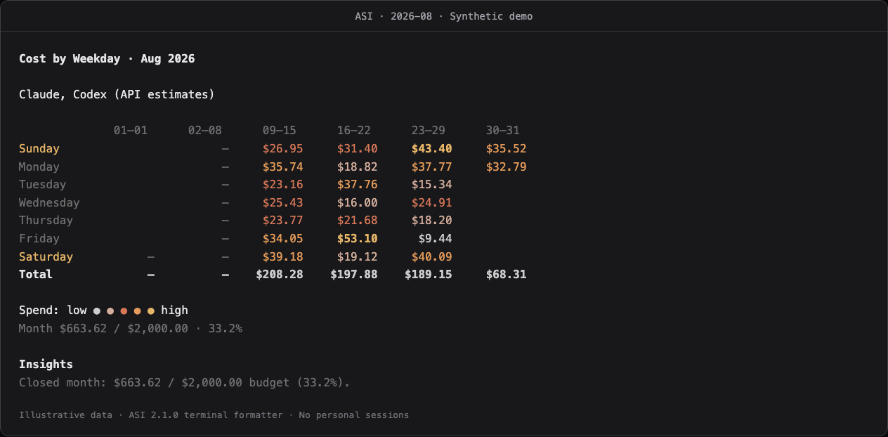
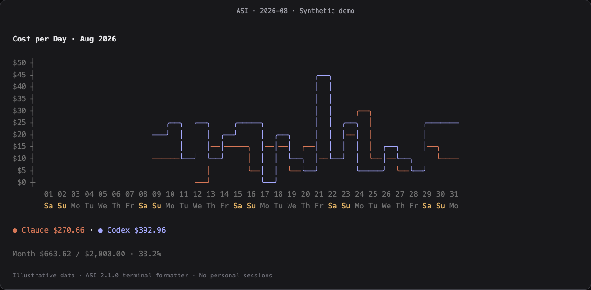
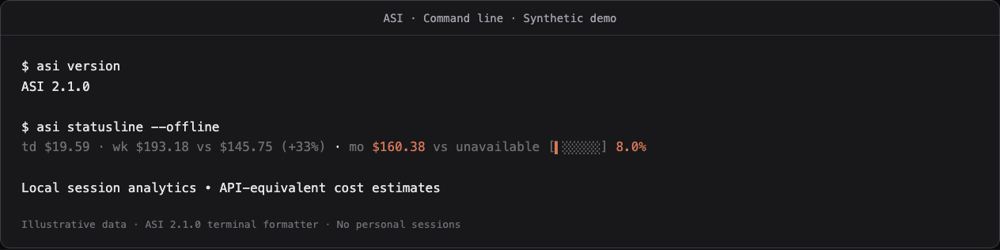
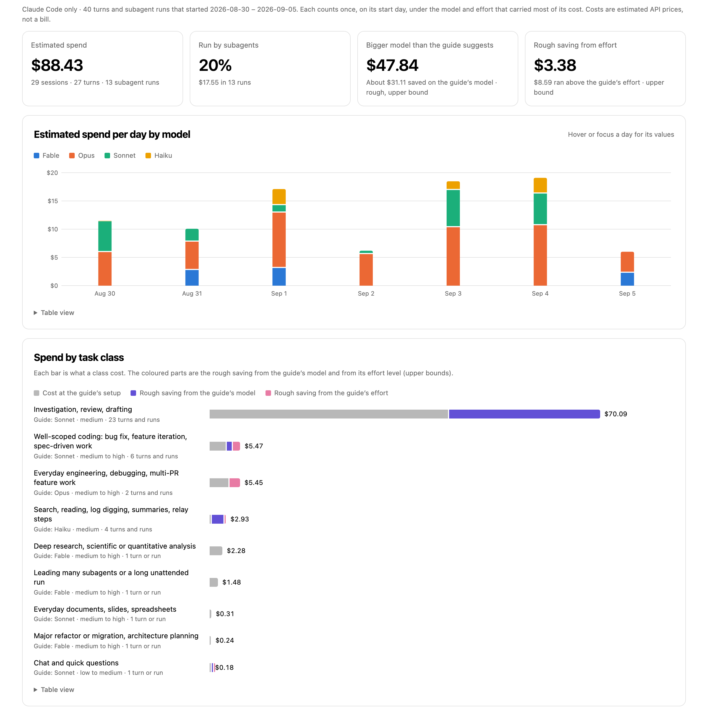

# ASI

An independent, on-demand analyzer of local Claude Code and Codex session files. Collect usage and event metadata, inspect sessions, and build an offline dashboard. Commands run on demand; the terminal dashboard waits for keyboard input and exits with Q/Escape. The optional skill invokes the same standalone commands.

**Python collector: 3.9+, standard library only.** No API keys, accounts, pip packages, Node.js or Codex plugins required. The optional enhanced terminal UI uses a bundled TypeScript/React/Ink module when Bun is installed; Python-only operation remains available. Collection and reporting happen on your device. Every command that reads your sessions opens no network connections or listening sockets; the single exception is `prices --refresh`, which reads published rates and sends nothing about your usage. It installs no MCP servers, hooks, telemetry exporters, app-server observers or background services. The optional macOS menu bar app refreshes locally while explicitly running. The optional skill checks GitHub for code updates without sending usage data, and supports offline use.

Since 2.0 it also answers a second question, [which Claude model and effort fit the work you did](#model-fit): each Claude Code turn and subagent run is compared with Anthropic's model guide, in the terminal, in the dashboard and through four skills. ASI was called AISAD before 2.0; see [Upgrading from AISAD 1.x](#upgrading-from-aisad-1x).

## See it work

Weekday view (`asi chart --view weeks`): known USD per weekday and calendar week with weekly totals, five spend-intensity colors and script-generated insights. `H`/`L` browse calendar months and the cells sweep in with the new month; `W` switches to the daily graph. Recorded from the maintainer's real local Claude and Codex history on version 1.4.3.



Daily graph (`asi chart`), same history: `H`/`L` browse calendar months and the daily lines morph into the next month, `W` switches to the weekday table.



Statusline, the optional spend forecast and its saved setting, recorded on the same real history:



*These recordings show real aggregate daily and monthly cost totals for one person, rendered from the actual terminal output. They contain no prompts, project names, session titles or file contents; the settings path is shown at its default location. The numbers are API-equivalent estimates, not invoices, and are specific to that history.*

The terminal recordings were made before the rename, so their window title and commands still say `aisad`; the output is the same.

The Model fit tab of the dashboard, on the synthetic demo data (`python3 scripts/make_demo.py`):



For the exact token formulas, cache-rate definition, pricing assumptions and comparisons with ccusage and Token Use, see [Usage accounting](docs/ACCOUNTING.md).

## Quick start

Clone into a writable directory and build a snapshot:

```sh
git clone https://github.com/aiatsuk/asi.git
cd asi
python3 agent_usage.py dashboard --open
```

The command reads existing local files, updates `output/sessions.sqlite`, writes a self-contained HTML file, opens it and exits. Rerun the command when you want fresh data. Opening or interacting with the dashboard does not collect anything.

ASI supports macOS and Linux. On macOS, `Run.command` performs the same one-shot action. Python 3.9+ and its standard library are sufficient; the collector remains a single portable file.

To update a clone, run `git pull --ff-only`. Existing snapshots remain usable offline.

## macOS menu bar (optional)

On macOS 14 or later, the native companion shows **Today** and **This week** in USD,
plus a **Day / Week / Month** chart of cumulative spend against the previous period.
Day uses hourly totals, Week uses daily totals, and Month adds your saved monthly budget.
The app remembers the chosen range. These charts use aggregate costs only.
The menu bar label contains only two compact monochrome lines, for example
**claude: 0%** and **codex: 75%**, showing aggregate weekly allowance remaining.
Each line uses natural text spacing. A dash means unavailable/expired; a tilde marks a
last-known reading. The label reuses existing quota data without extra provider requests.
Weeks start Monday; periods use your Mac's timezone.

Each total includes a USD/percent change: today versus yesterday at the same local time,
this week versus the same weekdays and time last week, and this month versus the same dates
and time last month. If the previous month is shorter, both comparisons use the common
complete days. Changes use a compact USD · percent line; hover to inspect the comparison
label, common day count and both exact windows.
Missing observations or uncertain prices show an unavailable comparison. A recorded zero
baseline shows the USD change without an undefined percentage.

With the CLI and native app installed, open the menu bar app with:

```sh
asi menubar
```

The launcher looks in `~/Applications` and `/Applications`, then asks macOS for the
registered app; a 1.x app is found too (see [Upgrading from AISAD 1.x](#upgrading-from-aisad-1x)). It does not build or install the app. `asi menubar --json` keeps
returning the aggregate report without launching the app.

From a clone, with Xcode Command Line Tools and Python 3.9+ installed:

```sh
./script/build_and_run.sh
```

This builds `dist/ASIMenuBar.app` and opens it as a menu bar accessory (no Dock icon).
The Codex Run action uses the same script. No login item is installed. Quit from the menu
stops the app and its refresh task. Use `--build-only` to build without launching.
This is a local development bundle; distribution signing is not configured.

On macOS Tahoe, ASI must be enabled in **System Settings → Menu Bar → Allow in the
Menu Bar** to show its icon. The app owns its insertion state and keeps running if macOS
hides the item. Reopening it does not override the system's visibility choice.
Snapshot export runs without constructing the menu-bar scene and does not stop the normal app.

The app refreshes local usage on launch, every five minutes while running, and when you click
the refresh icon with its last-update age (for example, **3 min ago**).
**Dashboard** collects current local usage before opening the offline HTML in your browser.
The page shows its collection timestamp. CLI and menu-bar collections publish a shared local snapshot; open CLI charts, the menu bar and a dashboard opened from its output directory follow that snapshot, normally within about a second. Each Dashboard open also updates spending from that same collection. The dashboard's calendar summary shows today, this week, this month and the saved monthly limit across all Claude/Codex sessions; filters apply to the detailed views below.
If collection fails, the app shows an error and preserves the previous HTML.
Today and this week sit in two compact cards. The larger monthly card contains a cumulative
spend chart: solid blue for the current month, dashed gray for the previous calendar month,
aligned by day number. The labelled horizontal line is the saved monthly budget; percentage
and reset countdown sit below the chart. Hover a day for both exact cumulative amounts,
or focus the chart and use Left/Right; Escape clears selection. The chart does not draw a focus ring. Today's point is partial,
while previous-month points include each whole day. Numeric comparison labels still use
the matched local-calendar windows described above. The chart and cards come from one
collection; refreshing or opening Dashboard updates them together.
Updates from CLI commands (including chart **R**), menu refresh and Dashboard publish the
same unfiltered spending data. The monthly budget saved from either interface also propagates.
CLI filters and month selection stay local to that view. Explicit alternative homes, log
directories, timezones and price files stay isolated. Closed/one-shot terminal output and
standalone dashboard copies remain snapshots. An already-open old version must be reopened
once after upgrading to enable synchronization.
The browser follows local script sidecars in the output directory; it runs no collector,
server or listener. Session lifecycle/event evidence retains its own collection timestamp
when a lightweight usage update arrives. Provider quota refresh schedules remain separate.

Dollar reports use the bundled local Python collector and make no network requests. **Monthly budget…**
edits the same `budget.json` as `asi budget --set USD`, preserving forecast settings.
There are no day/week limits. The default shared data root is `~/.local/share/asi`;
`ASI_DATA_DIR` overrides it and `ASI_PYTHON` can select a Python interpreter (1.x names
and data: [Upgrading from AISAD 1.x](#upgrading-from-aisad-1x)).
The clone's CLI normally uses `./output`: pass `--output ~/.local/share/asi/output`
to share settings with the app and installed `asi` command.

A row of **Claude**, **Codex** and **Grok** rings shows subscription limits below the spend
summary, each with its aggregate weekly percentage remaining; missing or expired weekly readings
show a dash. Each ring is an independent remaining allowance: the **outer ring** is the
short-term limit (normally 5 hours) and the **inner ring** the long-term one (normally weekly).
A provider that reports one aggregate window draws it as a single ring; no other allowance is
invented. Model-specific windows, including Fable when supplied, never add a ring. Rings are
never averaged.

Click a provider to open its pace popover:

- **Weekly left** with its reset time, and the pace against an even spend of the window:
  *behind pace* means less remains than an even spend would leave.
- **Runs out** projects the average rate so far to exhaustion; a window that would outlast its
  reset says so instead. Early in a window the projection is necessarily rough.
- A chart of the remaining allowance across the window, one column per day: the readings ASI
  already fetched, the dotted even-pace line and the projection. Hover it to read an earlier point.
- Every other window (session, model-specific weekly) with a bar, the percentage left and its
  reset, shown relatively within a day (for example, **resets in 2h 18m**).

**All providers** lists every reported window of every provider with its plan, bar, reset time
and freshness. Rings and bars are green at 80% or more remaining, amber from 30% and red below;
stale or expired readings are gray, and the menu bar label keeps its own warning thresholds
(orange below 20%, red at 10% or below).

The chart draws on `quota-history.json` in the output directory: the percentage and time of each
reading the app already fetched, at most 4,000 of them, dropped a day after their window resets.
It holds no credentials, prompts or session content and causes no extra provider requests;
deleting it only empties the chart until new readings arrive.

Provider data refreshes every minute while ASI runs. Opening a popover uses the latest reading and
does not send requests. The single footer refresh action updates both dollar usage and plan limits,
respecting provider cooldowns. Readings and reset times refresh their display every 30 seconds.
Unknown quotas show a question mark; stale/expired readings show a clock and never invent a refill.
Temporary failures retain the last reading; authentication failures clear it.

Limits use the existing signed-in Codex/Grok CLI over stdio and Claude's existing OAuth login
from its credentials file or macOS Keychain. Authenticated usage reads contact the provider;
credentials stay transient, are never logged or saved by ASI, and are never refreshed or
replaced by ASI. The app does not start model turns, import browser cookies, or change login
or system settings. A missing or inaccessible sign-in is shown explicitly.

Amounts are API-equivalent estimates for all local Claude/Codex sessions and pools,
not provider subscription quotas. Empty periods show **No data**; fully unpriced periods
show **Unpriced**. Ranges and unpriced subtotals stay visible, and missing days remain gaps. Spending can exceed the budget, and its percentage can exceed 100%. Errors retain the last successful report and its timestamp.

The [quota and cost audit](docs/agent/reports/provider-quotas-cost-audit.md) records live-source verification,
pricing checks and remaining estimation assumptions.

For aggregate JSON without the app:

```sh
python3 agent_usage.py menubar --json --output ~/.local/share/asi/output
```

Development checks: `python3 -m unittest discover -q`, `swift test --package-path macos`,
and `./script/build_and_run.sh --verify`. To render the actual native view in both
appearances without screen-capture access, use `./script/build_and_run.sh --snapshot /absolute/output/path`.

## Quick usage without a dashboard

```sh
python3 agent_usage.py usage
```

Example output:

```text
For Aug 30–Sep 5: $1,327.32 estimated API cost. In: 29M, Out: 1.28M
```

The command reads local traces, reuses the parse cache, prints the last seven days, and includes a comparison with the previous seven days when records exist. It generates no HTML, opens no browser and starts no server. These example numbers are illustrative; your report uses this device's actual recorded usage.

`In` is total input tokens, including cache reads and writes; `Out` is output tokens. Counts use K/M/B/T with up to two decimal places. The comparison covers estimated cost, input and output. JSON retains exact token counts, requests and sessions for detailed analysis.

Use JSON for scripts and agent analysis:

```sh
python3 agent_usage.py usage --json
python3 agent_usage.py usage --json --provider claude --days 30
python3 agent_usage.py usage --json --from 2026-08-30 --to 2026-09-05 --model gpt-6-astra
python3 agent_usage.py usage --json --all-time --include-requests
```

`--provider` accepts Codex/OpenAI or Claude/Anthropic, case-insensitively. `--model`, `--project` and `--role main|subagent|review` filter both periods. `--from` and `--to` are inclusive report-timezone dates. `--days` defaults to 7; `--to` can anchor a historical window. `--all-time` includes all observed dates with no comparison. Existing source, pricing, timezone and output options work with `usage` too.

`--json` writes one JSON object to stdout. Every usage run also saves `output/usage-report.json`. A usage answer needs only usage observations, so `usage`, `analyze` and `statusline` skip the event timeline entirely: they neither publish `output/sessions.sqlite` nor rewrite `output/usage.json`, which keeps a report to seconds on a multi-gigabyte history. `collect`, `sessions`, `session`, `dashboard` and `--include-events` publish both.

| JSON field | Contents |
| --- | --- |
| `schema_version`, `version` | Report schema and ASI release versions |
| `period`, `previous_period`, `filters`, `timezone` | Exact scope of the report |
| `current.totals`, `previous.totals` | Requests, distinct sessions, tokens, weighted cache share, pricing coverage and cost components |
| `current.by_provider`, `by_model`, `by_project`, `by_role`, `by_session`, `by_date` | Breakdowns; also present under `previous` |
| `current.rows`, `previous.rows` | Joint date/provider/model/session/project/role groups for custom analysis |
| `current.requests`, `previous.requests` | Optional normalized request records with `--include-requests`; no transcripts |
| `changes` | Comparison status and deltas; missing data and uncertain prices remain explicit |
| `quality`, `scan`, `source_summary` | Collection diagnostics over all discovered history, not just the filtered period |
| `price_as_of`, `price_sources`, `unknown_models` | Price provenance and unpriced models in the current filtered period |
| `current.telemetry`, `previous.telemetry` | Trace coverage and measured tool/MCP counts and sizes |
| `current.request_stats`, `previous.request_stats` | Per-request context, timing and numeric trace statistics with `--include-requests` |
| `pools`, `pool_scope` | Shared interactive and managed spend across all providers/projects for the selected dates |

`estimated_cost_usd` and `estimated_cost_high_usd` are null when no requests can be priced. With partial pricing they contain the known subtotal; check `unpriced_requests` before interpreting them as a complete total. `known_cost_usd` always names that known subtotal explicitly. `uncached_input_tokens + cached_input_tokens + cache_write_tokens` equals `input_tokens`. `cost_parts_usd` and `cost_parts_high_usd` give the lower and upper priced subtotals for each component. A nonzero range reflects unknown cache TTLs. `cache_share` is a fraction; its delta uses percentage points. Session counts are distinct within each group, so adding sessions across models or dates double-counts shared sessions. Missing dates are absent from the breakdown, not proof of zero usage.

## Session statistics

Use `usage --json --include-requests` to inspect request timing, input/output tokens, cache usage, and numeric tool/MCP counts and sizes. These records support questions such as “Which sessions had the largest tool payloads?” or “How did cache usage change this week?” Tool bytes are measured locally and are not converted into billed tokens. Missing tool telemetry is reported explicitly.

`analyze` remains an alias for `usage`, including JSON and filters. It returns statistics only. `usage`, `sessions` and the other reports do not generate recommendations, flag workflow patterns, or estimate hypothetical savings. There are two exceptions: the optional, off-by-default spend forecast below, which is a statistical projection of known cost, and [Model fit](#model-fit), which compares the model and effort that ran in Claude Code with a public guide.

Usage and status-line JSON now use `schema_version: 2`. Usage reports replace `diagnostics` with `telemetry` and `analysis_records` with `request_stats`; `analysis_rules` is removed. Status-line reports omit coaching fields. Token and cost totals, breakdowns, periods and comparisons keep their existing field names. The full `usage.json` snapshot exposes numeric request statistics in `request_stats`.

## Model fit

Which Claude model and effort fit the work you did? ASI compares the model and effort that ran in each Claude Code main-thread turn and subagent run with the guide [Which Claude model should you build with?](https://claude.dev/blog/which-claude-model-should-you-build-with/) (claude.dev, 2026-11-09), and shows where a smaller model or a lower effort would probably have done the job, and where a task may have been too hard for the model used. Codex sessions are not judged.

Like every other report, it reads local files on demand, makes no network or model calls, and changes no settings.

```sh
asi fit                          # period summary, last 7 days
asi fit --days 30
asi fit --session <id or prefix> # one session, turn by turn
asi suggest                      # what fits the session you are in, and what a switch costs now
```

`fit` takes the usual period flags (`--days`, `--from`, `--to`, `--all-time`), `--project`, and `--role main` (turns) or `--role subagent` (subagent runs). Cache events are main-thread calls, so they show only without `--role` or with `main`; `--role review` matches nothing, like an empty period. Model fit covers Claude Code only: `fit` refuses a `--provider` other than Claude, and `--model` and `--pool`, with a one-line error; `suggest` is about one session and refuses all five filters. `--json` prints one JSON object; `--include-titles` adds the shortened, redacted prompt to examples. A session prefix must be unique. An unknown session, a session without model calls and an empty period are reported as errors with a non-zero exit. `fit --session` always covers the whole session (narrowed by `--project` and `--role` when given), including subagent runs whose main transcript is gone; the period flags apply to the summary. `suggest` uses `--session`, then `CLAUDE_SESSION_ID`, then the newest session of the current folder.

Example summary (synthetic numbers):

```text
Model fit, 2026-10-12 to 2026-10-18 (UTC): $412.30 estimated across 18 sessions (96 turns, 140 subagent runs). Main threads $301.10, subagents $111.20.
By model: claude-opus-5-5 $330.40, claude-sonnet-5-5 $61.90, claude-haiku-5-5 $20.00
By effort: medium $90.10, high $180.50, xhigh $141.70

class        guide          units      cost  save model  save effort
everyday     opus/medium       60  $188.20       $0.00       $21.40
lookup       haiku/medium      95   $70.60      $48.30        $0.00
scoped       sonnet/medium     41   $64.00      $22.10        $5.60

Findings
- Work that a smaller model would have covered: $120 spent, about $70 saved at the guide's model (136 units)
- Subagents that ran on the session's big model with no model passed: 88 runs, $64; about $45 saved on the guide's model
- Opus at xhigh or max: $141 across 22 units

Could save about $70 by model and $27 by effort of $412.
```

`fit --session` adds the turns of one session (what was asked, what ran, the guide's pick and a verdict), subagents grouped by type, and the same findings for that session. The text also states that the numbers are estimates.

### The dashboard tab

The dashboard has a fifth tab, "Model fit", with the same period, project and role filters as the other tabs. It shows spend per day by model, spend by task class with the rough savings, the model used per class, spend by effort, findings with their largest examples, and the most expensive sessions. The tab only filters and adds up numbers that Python has already judged; open `asi run -- --open` or `asi dashboard --open` to see it.

### What the guide says

Start at the model and effort in the table; if the result falls short, add a self-check, raise effort one step, and only then go one model up at a lower effort.

| Task class | Model | Effort (start, then up to) |
| --- | --- | --- |
| Classification, routing, extraction; search, reading, log digging, summaries, relay steps | Haiku | medium |
| Chat and quick questions | Sonnet | low, then medium |
| Investigation, review, drafting | Sonnet | medium |
| Well-scoped coding; everyday documents, slides, spreadsheets | Sonnet | medium, then high |
| Everyday engineering, debugging, multi-PR work; computer use; not sure yet | Opus | medium, then high |
| Major refactor or migration, architecture; leading many subagents or a long unattended run; deep research | Fable | medium, then high |

`asi suggest` prints the full table with a reason for each class, the prices per million tokens, and the guide's effort ratios for Opus.

### How it judges

- **Units.** One typed prompt and everything done until the next prompt is a turn. One subagent run is a unit of its own.
- **Class.** A heuristic puts each unit in a task class from what happened in it: tools used, files edited, number of calls and a few keywords in the prompt. The guide gives the class its model and effort.
- **Verdicts.** `over`: a smaller model would have covered it. `under`: the work may have been too hard for the model that ran, a quality risk to check. `effort-over` and `effort-under`: the effort was above or below the guide's range. `session`: see below. `fits`: no difference.
- **Main threads are judged per session.** A main thread keeps one cache, and a model switch re-writes it, so its model is a per-session choice: the strongest model any substantial turn needed. A small turn in a session that also holds hard work gets the verdict `session`. That is not waste.
- **Subagents are judged per run.** Each has its own context, so each could have had its own model.
- **Effort is judged per unit.** Changing effort keeps the cache.
- **Savings** reprice the same requests on the guide's model through the same price rules as the rest of ASI, and apply the guide's effort ratios for Opus (low 0.33, medium 0.70, high 1.0, xhigh and max 2.5). Requests without a price are counted and left out.
- **Cache events** from the main thread are listed too: model switches, full cache rewrites after an idle gap of more than five minutes (not after a compaction), calls above 200k tokens of context, Haiku calls above 100k, fast-mode calls, and effort changes.

### Limits

- The heuristic sees tools and file counts, not how hard the thinking was. It marks candidates. Look at the examples before you change a default; the guide itself says to measure on your own tasks.
- Savings are rough upper bounds on API-equivalent estimates, not invoices. A smaller model or a lower effort can need more turns.
- The guide's table, effort ratios and prices will need updating when Anthropic changes them.
- Claude Code transcripts only. Cowork traces and Codex sessions are not judged.
- Fast mode is priced at the fast rate in the totals but repriced at the standard rate in the savings.

### First-message hint and autopilot (opt-in)

Both are plain instructions in Claude Code's `CLAUDE.md`. There are no hooks, and the installer does not switch them on.

```sh
asi rules on|off|status|show      # first-message hint
asi autopilot on|off|status|show  # model and effort for each subagent
```

They keep one block between `<!-- asi:begin -->` and `<!-- asi:end -->` in `~/.claude/CLAUDE.md` (or in `CLAUDE_CONFIG_DIR`). Text outside the markers is never changed; a file that is not valid UTF-8, or whose markers are broken, is left untouched with an error. The switches are saved in `model-rules.json` in the data directory.

- The **hint** asks Claude to open the reply to the first message of a main interactive session with a note of two or three lines: the task class, the guide's model and effort, and whether the current model fits. It is told to stay silent in subagents, headless runs, scripted prompts and fixed-format replies.
- **Autopilot** asks Claude to choose and pass a model and effort for each subagent and workflow agent it spawns, where nothing is named already. It never switches the main session's model, because a switch re-writes the whole cache.
- The two switches are independent and both start off: `asi rules on` writes only the hint, `asi autopilot on` only the autopilot rules. `status` shows what is switched on and whether the block is on disk. With both off, the block is removed. `rules apply` rewrites the block from the saved state.

### Skills for Claude Code

`asi install --target claude` links four sub-skills next to the `asi` skill. They are links for Claude Code only; a Codex install gets none. They set no `model` or `effort` of their own, because a one-turn model switch would re-write the session's cache.

- `/asi-suggest [task]`: which model, effort and modes fit the work in this conversation, and what switching now would cost.
- `/asi-analyze [session]`: one session turn by turn (`fit --session`), with the examples checked by the model. Defaults to this session.
- `/asi-autopilot on|off|status`: switch autopilot (`autopilot`).
- `/asi-ultraanalyze [7d|30d|all|A..B]`: every session in a period, with examples that the model reads and judges, and the dashboard.

## Collect and inspect session evidence

```sh
python3 agent_usage.py collect --json
python3 agent_usage.py sessions --json
python3 agent_usage.py session --session Codex:SESSION_ID --json
python3 agent_usage.py session --session Claude:SESSION_ID --tree --all-time --json
python3 agent_usage.py session --session Codex:SESSION_ID --json --offset 200 --limit 200
python3 agent_usage.py usage --json --include-requests --include-events
```

Each command gathers existing files when invoked. `collect` returns a database summary. `sessions` and `session` return date-scoped own/tree costs, tool statistics and a paginated event timeline. They share usage's date, provider, model, project, role and pool options. Seven days is the default; use `--all-time` for the complete observed history. `--tree` includes confirmed descendants. Timeline pages default to 200 events and support up to 10,000; follow `next_offset` until it is null. Events without timestamps remain in SQLite but cannot be placed in a date-filtered report; `undated_events` reports their count for the selected sessions. Tool result sizes remain unknown when payloads are absent; `results_without_size` identifies this coverage gap.

`own` counts a session's observations; `tree` includes its confirmed descendants once. Tree totals overlap and must not be added together. Lifecycle and explicitly named `lifetime` fields use all observed history. A completed turn is not proof that a session is currently completed: state stays `unknown`, with `last_seen` and the last recorded lifecycle event. Elapsed time includes idle periods; active time remains unavailable.

The dashboard contains Charts, Sessions, Context, Cache usage and Model fit. Select a daily bar, model or project to narrow the session list. Open a session and select a point on its input chart to inspect the usage record and source references. The offline HTML contains at most the latest 200 metadata events per session; use the CLI or SQLite for complete history. These event previews share a budget of 64 MB, newest sessions first, so a long history still opens; the detail of an older session then says its events are not in the file and names the command that shows them (`asi session --session ID --all-time --json`). Set `ASI_PREVIEW_BUDGET_MB` to another positive number of megabytes to change the budget. Costs, requests, session statistics and Model fit always cover the whole history. A large history is saved in the HTML in compressed parts that the page reads one after another before it opens. Outside the Model fit tab, recommendations and hypothetical savings remain disabled.

### Local event database

`sessions.sqlite` contains `source_files`, `sessions`, `turns`, `events`, `event_sources`, `usage_observations`, `observation_events`, `tool_calls`, `context_snapshots` and `metadata`. Event schema version 1 is stored in `PRAGMA user_version`. Existing usage JSON remains schema version 2 with additive evidence fields.

A collection updates the database in place: `source_files` records each trace's size and mtime, and only the sessions whose traces moved are rewritten, inside one transaction. `metadata.build_signature` covers the collector version, parser and price catalog, so changing any of them rebuilds every row rather than leaving stale costs behind.

For example, open the database read-only from Python:

```python
import sqlite3
from pathlib import Path

path = Path('output/sessions.sqlite').resolve()
connection = sqlite3.connect(path.as_uri() + '?mode=ro', uri=True)
try:
    print(connection.execute('SELECT model, SUM(input_tokens), SUM(estimated_cost_usd) FROM usage_observations GROUP BY model').fetchall())
finally:
    connection.close()
```

`event_sources` provides the source-file ID, line, byte offset and parsed-record SHA-256 fingerprint. Resolve paths through `source_files`. The fingerprint is SHA-256 of ASI's canonical JSON representation (`evidence_id(raw_record)`), not a hash of the raw line bytes. Request records link to events through `observation_events`; `request_stats.evidence` exposes those references in JSON and HTML. The selected price catalog is saved in database metadata and `prices-used.json`.

The database is a derived snapshot, rebuilt transactionally from discovered sources and the parse cache. Repeated collection does not add usage. Copied records are deduplicated; removed source files disappear from the next snapshot. An interrupted database transaction preserves its previous complete state. Files can continue growing while they are read: each read stops at its initial size, tolerates an incomplete final line, and reports collection issues in `quality`. Different files are not an atomic snapshot of the running applications.

Only allowlisted metadata is retained. Prompts, replies, reasoning, tool arguments, result bodies and compaction summaries are not copied. There is no transcript-recording mode. Source references let you inspect originals locally while they still exist; they do not preserve deleted conversation content.

### Measurement limits

Usage and session JSON expose `measurement_basis`: tokens and logged result bytes are measured; API cost is estimated; active time, exact context composition, loaded tool definitions, repeated tool-result input and invoices are unavailable. Logged result size does not establish how much reached a model or remained after compaction. Cache reads still consume context. The most recent request's input is a historical observation, not live context utilization.

### Migration from monitoring modes

`--watch` and `--stdin` are rejected before collecting. No dashboard server or browser polling remains. `statusline` is retained only as a manually invoked one-shot text/JSON snapshot. If you previously configured an external status hook or scheduler, remove that configuration yourself; ASI does not edit other tools' settings.

## Status line

```sh
python3 agent_usage.py statusline
python3 agent_usage.py statusline --monthly-budget 3000 --color
python3 agent_usage.py statusline --json
```

ASI prints one compact line; Claude Code's own mode indicator can appear beneath it:

```text
td $11.45 · wk $647.75 vs $353.64 (+83%) · mo $950.02 vs $1,156.65 (-18%) [██▊░░░] 47.5%
```

The line shows today's estimate first, then calendar-week-to-date spend (Monday through today) versus the same weekdays in the previous week, followed by monthly spend and comparison, and the compact monthly-budget bar. For example, Monday–Thursday compares with Monday–Thursday one week earlier. Both weekly windows and today's estimate include all discovered Claude/Codex sessions and agent pools, independent of report filters. A cost delta appears only when both windows have comparable priced observations. Monetary amounts omit `+`; positive comparison deltas retain it. Incomplete-pricing metadata remains in JSON; no records show `unavailable`, and wholly unpriced observations show `unpriced`.

The budget remains **calendar-month-to-date** against a **$2,000 default monthly limit**, across all discovered sessions and agent pools. `--monthly-budget USD` overrides the saved limit for this run. The month follows `--timezone` (system local timezone by default) and resets on the first day. Existing `--budget` and `--managed-budget` remain separate selected-period pool budgets in JSON and the dashboard.

The `mo` block shows monthly spend followed by the previous-month subtotal and delta; the bar and budget percentage come last. They use equal day windows from the start of each month. If the previous month is shorter, an explicit `28d CURRENT vs PREVIOUS` (or `29d`/`30d`) shows both comparison subtotals, while the amount before the bar still covers the complete current month to date.

The bar is six terminal cells wide, with eighth-cell precision, a dark gray background and a percentage beside it. Its fill is warm coral below 65%, amber from 65%, orange from 80% and red from 100%. The fill caps at the limit while the percentage continues to show overspend. Budget percentages omit `+`; JSON retains pricing coverage. Terminal output enables colors automatically; `--color` forces ANSI colors in piped output, and `--no-color` disables them. `NO_COLOR` and `TERM=dumb` disable automatic colors. Both colored and plain output bracket the bar and use shaded unused cells, with one space between each block.

`statusline --json` retains the session, harness, pool and selected-period summary fields and exposes `weekly` and `monthly_budget`. Monthly comparison metadata remains available in `monthly_budget.comparison`: equal day windows from the beginning of each month, capped to the last common day if the previous month is shorter, while the budget includes every current-month day through today. Missing history is unavailable rather than assumed zero; costs are API-equivalent estimates, not subscription billing or enforced caps. The command prints one snapshot and exits.

## Spend forecast and suggested budget

`budget --forecast on` enables an optional, deterministic Python forecast; `forecast` prints it (`--json` for fields). It forecasts known API-equivalent cost for the current Monday–Sunday week and calendar month and suggests a budget, the chosen quantile (default 80%, `budget --quantile Q`, 0.5–0.99) of the forecast. Nothing is sent anywhere, no model is involved, and the saved limit is never changed: only `budget --set` does that.

- **Data:** all Claude/Codex sessions and pools, independent of display filters. A day without requests counts as $0; a wholly unpriced day or a day before the first record is missing. At least three complete Monday–Sunday weeks of history and ten days with priced spend in the last 21 days are required, otherwise the reason is printed.
- **Method:** an exponentially weighted weekday profile (14-day half-life, weekend and weekday classes shrunk to their group) summed over the actual days of the period. The target is a Student-t log-spread quantile until six earlier outcomes can be replayed from local history, then the quantile of those outcome ratios. Output says `uncalibrated` or `calibrated` and a low/medium/high confidence; low pricing coverage and a recent level shift lower confidence.
- **Frozen:** each week's and month's forecast uses only earlier days and is written once to `output/forecast.json`; it does not move during the period. `pace` (actual to date plus the same profile for the remaining days) is a separate number. A finished period receives its actual so accuracy can be checked. Changing the quantile applies from the next period.
- **Limits:** spend is bursty, so even the best methods are often off by a large fraction (about 70% weekly in the maintainer's own backtest), and unpriced models lower the known total. Treat the target as a planning aid, not a prediction of the bill.

## Terminal dashboard and saved budget

```sh
asi chart --offline --color
asi chart --offline --color --interactive
asi chart --offline --color --snapshot
asi chart --offline --color --view weeks --month 2026-09 --snapshot
asi chart --offline --json
asi budget
asi budget --set 3000
asi budget --reset
asi budget --forecast on --quantile 0.8
asi forecast
```

`chart` opens a keyboard-driven view when both input and output are a terminal, or prints one snapshot when piped or given `--snapshot`: days 01 through the last day of the selected calendar month (current by default) on the horizontal axis, daily USD cost on the vertical axis with automatic rounded steps. Every day has a number and a two-letter weekday beneath it; weekends are highlighted. The whole month always stays in one plot, so month changes morph at any width: three columns per day from about 100 columns, two columns with odd day numbers and a weekday initial under every day from about 70, and one column with weekly day numbers (01, 08, 15, 22, 29) and initials below that, down to 48 columns. The weekly table likewise keeps every week side by side: it shortens weekday names, then drops cents, before splitting into panels. Claude, Codex and other observed providers have separate colored step lines with rounded corners and a compact legend; use `--color` to force colors, `--no-color` to disable them, or `--ascii` for plain ASCII line drawing. It fits the terminal width (48–240 columns) and supports a 4–30-row maximum height. Dates follow `--timezone`, and future dates remain blank. Use `--month YYYY-MM` for another calendar month; custom date ranges belong to `usage`.

The enhanced terminal view uses strict TypeScript, React and public upstream Ink, built into one module with Bun. Ink manages layout through Yoga, key handling, live terminal resize and alternate-screen cleanup. Python still collects and prices usage; the UI receives only monthly numeric aggregates, never transcript text, source paths or project names. Navigation reuses those aggregates and does not open network connections or rescan sessions.

When the bundled UI and Bun are available, `asi chart` selects it automatically. Otherwise the portable Python view remains available. Set `ASI_TERMINAL_UI=python` to select that view explicitly. Snapshot and JSON commands continue to use Python without launching the UI. The enhanced UI browses loaded months, from the earliest available history/requested month through the current month.

For UI development and a local bundle:

```sh
cd ui
bun install --frozen-lockfile --ignore-scripts
bun run check
bun run test
bun run build
cd ..
python3 scripts/build_release.py --tag v1.5.0 --with-ui
```

The UI bundle includes its dependencies and third-party notices; no package installation is needed at runtime. Packaging checks source fingerprints and refuses a stale UI build. Omitting `--with-ui` builds the existing portable Python package.

In the terminal, press **W** to switch between the graph and a weekday table, **H** for the previous month, **L** for the next month (up to the current month), and **Q** or Escape to exit. Left/right arrow keys also change months. `--interactive` requires a terminal; `--view weeks --snapshot` prints the table without waiting for keys. Navigation reuses the initial local snapshot; it does not poll, rescan, start a server or reach the network. Exiting restores the terminal.

The Ink UI animates in the style of the Codex CLI welcome mark. When the graph opens, its lines grow out of the $0 baseline from left to right; between months they flow into the next month's lines. Particles are bound to provider and day and transfer from the dots on screen: a day's dots move up or down in place, split off when its line grows and merge when it shrinks, and new days flow in from neighbouring days; only a provider with nothing within about four days dissolves or grows from $0. The plot keeps one height and one y-axis width for every month, so each morph starts exactly on the dots shown. A wave crosses the occupied span in the navigation direction (H and L mirror it); particles hop along arcs, lift toward the camera with perspective, glow in flight, flash as they land with a slight overshoot and leave short comet tails where they move fast. Colors blend between providers and the plot tilts slightly. Rendering uses a per-dot z-buffer and studio lighting (key, shadow, cool rim and a warm specular glint) averaged into one truecolor foreground per Braille cell. Text and table cells sweep in from a dimmed state in the same direction. Provider amounts in the legend and the monthly budget amount and percentage roll from the previous month's values (a new provider counts up from $0) with a slight stagger; digits that are still changing glow warm and flash as they settle. A 20-cell, two-row minimap shows the selected month's real daily costs in provider colors. It stays visible in both graph and weekly views; left to right covers the full calendar month, with a shared vertical scale based on that month's largest provider daily cost. Gaps/future days stay blank and unpriced days retain `?`; thin connected lines retain provider/day correspondence while morphing, missing samples fade in place, and a light band sweeps across during the morph. Coincident lines share a terminal cell's foreground color. The plot keeps the same number of rows for every month (finer 1/1.5/2/2.5/3/4/5/6/8 ticks keep the top within a third of the maximum), so navigation never moves the legend or footer. Exact costs, axes and table cells stay ordinary text, and every animation settles to the exact colors and glyphs. Transitions prepare before the first new-month frame: plot and minimap morphs and graph text take 620 ms, the opening growth 700 ms and weekly-table sweeps 420 ms, all with quintic easing (zero endpoint velocity and acceleration). Animation stops at rest; rapid input retargets from the visible particle positions. Lighting assumes a dark terminal background; 256- and 16-color terminals receive the nearest palette colors. Set `ASI_REDUCED_MOTION=1` to disable movement. Screen readers, CI, ASCII, no-color output and the Python fallback stay static. Narrow/multi-panel graphs switch directly while the minimap provides the transition. Resizing settles graph geometry immediately; narrow terminals use a 16-cell minimap. Animations share one 8 ms clock (about 120 fps); unchanged rows are cached, so a frame costs about 2 ms even on a slow machine. Outside screen-reader mode the dashboard writes frames itself: it rewrites only changed lines inside a synchronized terminal update, while Ink keeps input, resize and terminal restoration (see [ADR 0003](docs/agent/adr/0003-direct-frame-writer.md)). To measure actual terminal pacing on your machine, run `python3 ui/test/pty_performance.py` after building the UI.

The interactive chart opens on the dataset it showed last time (`output/chart-ui.json`, monthly aggregates only, keyed by version and options), marked "Updating…" in the footer, while the collector rescans traces in the background. When fresh numbers arrive, changed months morph and roll to them; unchanged months stay still and the selected month is kept (or follows today's month if you have not navigated). Quitting before the refresh ends exits immediately. The first launch, or a launch with other options, waits for the scan as before. Press R at any time to collect again without leaving the chart; the footer shows "Updating…" until the new numbers arrive (one collection at a time; a failure keeps the shown numbers and is reported on exit).

The weekday table has seven rows, Sunday through Saturday, and a column per Sunday–Saturday calendar week. Each cell shows only that day's known USD subtotal. Partial first/last weeks keep dates outside the month blank; unknown/future days show `—`, wholly unpriced days show `?`, and observed zero spend shows `$0.00`. Daily cells use five equal spend bands relative to the month's largest known daily subtotal: primary text, muted warm, coral, orange and amber; the highest band is bold. A final Total row shows each column's known weekly subtotal, keeping empty/unpriced columns distinct from observed zero. Below the table, Python generates a deterministic Insights line with the budget forecast; the highest average spending weekdays over the last four completed weeks stay in JSON (`insights.busiest_weekdays`). Default cells combine Claude/Codex API estimates; Grok remains separate. With `--provider grok`, cells show Grok's reported cost. `chart --json` includes the same matrix in `weekday_view`.

Run the command in the terminal to see the actual colored chart; an ASCII reconstruction in an assistant message is not a faithful preview. `--ascii` is an explicit compatibility fallback. Only recorded daily observations are plotted. Gaps remain gaps, wholly unpriced days show `?`, and overlapping series keep the visible provider's color. Incomplete pricing/coverage remains explicit in the footer and JSON. Claude/Codex costs are API-equivalent estimates; Grok, when available, uses its provider-reported completed-turn cost and is labelled `reported`. The shared budget continues to cover Claude/Codex; Grok reported costs stay separate. Other providers appear when supported local observations exist. `chart --json` also saves `output/chart.json` with exact daily values and coverage.

`budget` reads the saved monthly limit without collecting sessions or reaching the network. `budget --set USD` atomically saves a finite positive amount, and `--reset` restores $2,000. The setting lives in `output/budget.json` under the selected data directory, outside the replaceable skill. Codex and Claude helpers share it by default. Statusline and the terminal chart use the saved limit; `--monthly-budget USD` overrides it for a single run. The existing local Claude statusline also honors the saved setting, unless `AISAD_MONTHLY_BUDGET` explicitly overrides it.

To add the `asi` terminal command when installing a local bundle, use `--cli-dir` pointing to a directory already on your PATH:

```sh
python3 skills/asi/scripts/asi.py install --target both \
  --archive dist/asi-skill-vX.Y.Z.zip --checksum-file dist/SHA256SUMS \
  --cli-dir "$HOME/.local/bin"
```

This installs a small launcher without editing shell settings and refuses to overwrite an unrelated existing command. An `aisad` command that the 1.x installer wrote in the same directory now runs `asi`. Without it, invoke the installed helper with Python and the same commands. The existing offline HTML dashboard remains available through `asi run --offline -- --open`.

## Install the skill

From a clone of this repository:

```sh
python3 skills/asi/scripts/asi.py install --target codex
```

Use `--target claude` for Claude Code or `--target both` for both applications. Defaults are `~/.codex/skills/asi` and `~/.claude/skills/asi`, honoring `CODEX_HOME` and `CLAUDE_CONFIG_DIR`. Use `--dest '/path/to/skills'` for a custom skills parent directory, or `--version X.Y.Z` to install that published ASI release. The package includes its own collector; you do not need to keep the clone afterward.

You can also ask Codex's skill installer to install `skills/asi` from `aiatsuk/asi`. A raw GitHub skill installation downloads its bundled runtime on first use. A release installation already includes the runtime and works offline immediately.

In a new turn, invoke `$asi usage` in Codex or `/asi usage` in Claude Code. Ask follow-up questions such as:

- “Which models cost the most this week?”
- “Compare Claude and Codex with the previous week.”
- “Which sessions explain the increase in estimated cost?”
- “Show cache usage for this project over the last 30 days.”
- “Show the largest recorded context and tool payloads by session.”
- “Inspect this session’s recorded events and tool calls.”

`--target claude` also links four sub-skills next to the skill: `/asi-suggest`, `/asi-analyze`, `/asi-autopilot` and `/asi-ultraanalyze` (see [Model fit](#model-fit)). Anything else already at one of those paths is kept: the installer prints one line for each sub-skill it skipped and a count, and still exits 0 because ASI itself is installed. A Codex install gets none. The installer does not write to `CLAUDE.md` and does not switch the first-message hint or autopilot on.

The skill collects JSON and computes answers locally. It uses the text command for a quick summary and opens the dashboard when requested. Its instructions are in [skills/asi/SKILL.md](skills/asi/SKILL.md).

For this unreleased source version, build and install the local bundle without contacting GitHub:

```sh
python3 scripts/build_release.py --tag vX.Y.Z
python3 skills/asi/scripts/asi.py install --archive dist/asi-skill-vX.Y.Z.zip --checksum-file dist/SHA256SUMS --target codex
```

### Upgrading from AISAD 1.x

ASI was named AISAD (AI Session Analysis Dashboard) up to 1.5.2. A 1.x installation cannot update itself to ASI: its updater accepts only AISAD release files, so it stays at its version and keeps working. Run the ASI installer once, as above. The ASI installer installs ASI releases only. What carries over:

- The skill moves to `skills/asi`. An unmodified 1.x `skills/aisad` next to it is removed; one with local changes, or one the installer cannot verify, stays where it is and the installer prints one line about it.
- With `--cli-dir`, an `aisad` command that the 1.x installer wrote there now runs `asi`.
- The first `asi` command that writes to the data directory moves `~/.local/share/aisad` to `~/.local/share/asi` (budget, reports, forecast and update state), unless a data directory is configured. Commands that only read (`version`, `rules status|show`, `autopilot status|show`) never move it: they use the new directory if it exists, otherwise the old one. If the move fails, it keeps using the old directory and says so on stderr. The menu bar app never moves data: it uses `~/.local/share/asi` if that exists, otherwise `~/.local/share/aisad` if that exists.
- `ASI_*` environment variables replace `AISAD_*`. An `AISAD_*` variable still applies when its `ASI_*` twin is unset or empty.
- Dashboards, the terminal chart and the menu bar app also follow shared updates written by 1.x, and a dashboard theme saved by 1.x still applies.
- `asi menubar` opens `ASI.app` or `ASIMenuBar.app`, then a 1.x `AISAD.app` or `AISADMenuBar.app`. The rebuilt app has the bundle ID `com.aiatsuk.asi.menubar`, so macOS treats it as a new app: allow it in the menu bar again, and the remembered chart range starts at Week.

### Updates and offline use

The installed helper supports:

```sh
python3 ~/.codex/skills/asi/scripts/asi.py version
python3 ~/.codex/skills/asi/scripts/asi.py check-update
python3 ~/.codex/skills/asi/scripts/asi.py update
python3 ~/.codex/skills/asi/scripts/asi.py usage --json
python3 ~/.codex/skills/asi/scripts/asi.py usage --offline
python3 ~/.codex/skills/asi/scripts/asi.py analyze --json
python3 ~/.codex/skills/asi/scripts/asi.py sessions --offline --json
python3 ~/.codex/skills/asi/scripts/asi.py run -- --open
```

Substitute your installed skill directory if it differs. `usage`, `analyze`, `statusline`, `chart` and `run` check for a newer stable release at most once every 24 hours when invoked. The check runs in a detached background helper (`asi.py maintain`, output in `maintenance.log` in the data directory), so a report never waits for it; a newer release replaces the skill, launcher and collector together and applies from the next launch. Update messages go to stderr, keeping JSON stdout clean. `check-update` checks immediately without replacing code; `update` applies a newer release immediately. Existing HTML files remain fixed until another dashboard command generates a new snapshot.

Checks and downloads contact only the public GitHub repository for release metadata and code. They transmit no traces, metrics or device identifiers. `--offline` skips those requests. Set `ASI_AUTO_UPDATE=0` to disable automatic checks persistently in your environment; explicit `check-update` and `update` still work. If an automatic check fails, the installed version remains usable. No scheduler or startup service is installed.

Skill reports default to `~/.local/share/asi/output`, outside the replaceable installation. `ASI_DATA_DIR` or the helper's `--data-dir` selects another local data directory. Collector arguments can follow `--`; keep custom outputs outside the skill directory. Updates verify SHA-256 checksums and the package manifest, preserve local modifications by refusing to overwrite them, and restore the previous installation if replacement fails.

For offline installation, download the skill ZIP and `SHA256SUMS` from a [release](https://github.com/aiatsuk/asi/releases), then use a local copy of the helper:

```sh
python3 skills/asi/scripts/asi.py install \
  --archive asi-skill-vX.Y.Z.zip --checksum-file SHA256SUMS --target codex
```

## What you can explore

- The last seven days by default, compared with the preceding seven days when records exist.
- Provider totals for OpenAI/Codex and Anthropic/Claude; click a provider to filter the dashboard.
- Tokens and estimated cost by model, day, project and session.
- Uncached input, output, cache reads and 5-minute/1-hour cache writes.
- Main threads, subagents and auto-review where roles are recorded.
- Global period, date, provider, model, project, role and pool filters; a searchable, sortable session table with request timelines.
- Context and tool footprints, cache usage, and a token/cost breakdown for uncached input, cache reads, cache writes and output.
- Trace coverage, parsing diagnostics and requests with unknown prices.
- Model fit: spend per day by model, spend by task class with rough savings, the model and effort used per class, findings with examples, and the most expensive sessions (Claude Code only).

Session titles are excluded by default; the dashboard uses session IDs and project names. `--include-titles` adds shortened titles with basic redaction of obvious secrets. This is not comprehensive anonymization. Message bodies, reasoning, tool arguments and tool results are not saved in the export. Model fit follows the same rule: its reports and the dashboard tab carry no prompt text unless you pass `--include-titles`, and then only the shortened, redacted title of a turn or subagent run. Edited file paths are kept only as short hashes.

## Periods and comparisons

The default **Last 7 days** includes the snapshot date and the six preceding calendar days, using the report's timezone. For example, a September 5 snapshot shows August 30–September 5 against August 23–29. An old trace does not move the window backward. The window advances when you next run the collector.

Choose **This week (Mon–today)** for the current calendar week so far, compared with the same weekdays last week. **Last week (Mon–Sun)** shows the previous complete calendar week, compared with the calendar week before it. Both use the snapshot date in the report's timezone. **Today**, **This week** and **This month** compare up to the same local time as the snapshot, matching the menu bar. If the previous month is shorter, the month comparison uses the same complete dates in both months. The displayed month total still includes the full month to date. Incomplete pricing suppresses monetary deltas; known subtotals carry a plus sign.

You can also choose **Last 30 days**, **All time**, or enter a custom date range. Rolling and custom ranges are compared with the immediately preceding range of equal length. All time has no comparison, and Reset restores the last seven days with all providers selected.

Summary cards show percentage changes and previous values; cache rates show changes in percentage points. The daily chart aligns the previous period by day, with actual dates available on hover. Provider, model, project, role and pool filters apply to both periods. Search only affects the sessions table.

Comparisons use recorded observations, not guaranteed complete coverage. The current day is partial. Missing previous-period records are labeled explicitly, and missing current records do not produce a false 100% decrease. A zero baseline has no percentage change. Cost totals and deltas use known priced requests in each period. Unpriced requests are excluded from monetary comparisons and disclosed separately; request and token counts retain all observations. No priced observations means unavailable cost, not zero. Price ranges still suppress a single percentage delta.

## How cost is estimated

**Local token counts cannot reveal subscription charges, remaining account limits or a provider invoice.** Even Claude SDK `total_cost_usd` is an estimate. ASI does not add it to request-level costs because it may already include subagents and cumulative totals across turns.

Rates calculate an **API-equivalent estimate** from each model's input, output, cache usage and available processing mode/geography. It is a current-rate scenario applied to the available history, not a reconstructed billing history. Reports use the refreshed catalog when one exists, the built-in table otherwise, and `price_as_of`, `price_basis` and `price_sources` always name which.

### Refreshed rates

```sh
python3 agent_usage.py prices --refresh    # read published rates
python3 agent_usage.py prices --json       # what is stored locally
```

`prices --refresh` is the only outbound request the collector ever makes, and it happens only when asked. It reads [models.dev](https://models.dev/api.json), revalidates with the stored ETag, and keeps the last good catalog if anything fails: an oversized response, a payload that carries no first-party model, or rates the pricer would reject. The result lands in `output/prices-models-dev.json` beside a metadata file with the ETag, fetch time and payload SHA-256.

Only the `anthropic` and `openai` providers are read, so a reseller entry never shadows a first-party rate. Published base rates, context tiers and fast-mode rates become `input`/`cached`/`write_5m`/`output`, `long_threshold` with its multipliers, and `fast_multiplier`. What that source does not publish — Anthropic's one-hour cache writes, the flex and batch discounts — stays at its built-in value, and a model missing from the source keeps its built-in rate rather than turning historical observations unpriced. Models it publishes that ASI did not know about are added.

The launcher (`skills/asi/scripts/asi.py`) refreshes at most once every 24 hours in the background, alongside its existing update check; new rates apply from the next report. `--offline` or `ASI_AUTO_PRICES=0` disables that; the refresh never blocks or fails a report.

Missing tiers default to Standard and missing geography defaults to global. An unknown model or unsupported mode has a missing price, not a zero price; the request is excluded from the displayed cost subtotal and comparison, with its count disclosed separately. If a Claude cache-write TTL is unknown, cost is shown as a 5-minute to 1-hour range.

The dashboard explains partial pricing in **Excluded from cost**, with counts, tokens and reasons for the selected filters. `current.pricing_coverage` and `previous.pricing_coverage` expose the same grouping in usage JSON. Internal `codex-auto-review` observations have no published rate. They are priced as `gpt-5.6-luna`, the model Codex runs auto-review on with an API key, and every such row carries the assumption "Codex auto-review priced as gpt-5.6-luna, its API-key model"; they are never silently treated as free.

## Local pricing overrides

Create and edit a local price catalog:

```sh
python3 agent_usage.py --write-prices prices.json
python3 agent_usage.py --prices prices.json --open
```

`models` maps model IDs to `input`, `cached`, `write_5m`, `write_1h` and `output` rates in USD per million tokens. To describe historical prices, replace a model's rate object with a list of objects using `valid_from` (inclusive) and `valid_to` (exclusive). Zero or multiple matching rules leave the price unknown.

Supported adjustments include `long_threshold`, `long_input_multiplier`, `long_output_multiplier`, `long_scope` (`session`, or per request by default), `fast_multiplier`, `flex_multiplier` and `batch_multiplier`. `as_of` records when the catalog was checked. A local `--prices` file overrides both the refreshed catalog and the built-in table.

Explicitly recorded server-side web searches are included at $0.01 per search. Other service fees, discounts, taxes and missing telemetry are not reconstructed. Output counts come from traces, which can contain intermediate SDK values; estimates reflect only the recorded observations.

Sources: [OpenAI pricing](https://developers.openai.com/api/docs/pricing), [Claude pricing](https://platform.claude.com/docs/en/about-claude/pricing), [Claude SDK cost tracking](https://code.claude.com/docs/en/agent-sdk/cost-tracking).

## Local data sources

- **Codex:** `$CODEX_HOME` or `~/.codex`; `sessions`, `archived_sessions` and the newest readable `state_*.sqlite` registry.
- **Claude Code:** `$CLAUDE_CONFIG_DIR` or `~/.claude`; `projects`, including nested `subagents`.
- **Claude Cowork:** local audit traces under macOS Application Support, read by default when present; `--no-cowork` skips them.

Override the directories when needed:

```sh
python3 agent_usage.py --codex-dir '/local/path/Codex' --claude-dir '/local/path/Claude' --output '/local/path/Report'
```

`--home '/path/to/profile'` selects another local profile. In this mode, `CODEX_HOME` and `CLAUDE_CONFIG_DIR` are ignored unless explicit source directories are supplied. The timezone defaults to the system setting. Use `--timezone Europe/Amsterdam` to override it; this requires an installed IANA timezone database, available on standard macOS systems.

Source SQLite databases are opened read-only. The parser handles incomplete final JSONL records, cumulative counter resets and missing directories. Changed files are reread; unchanged files use a local cache. Removed source files disappear from subsequent snapshots and are removed from the cache. Duplicate messages across files are counted once; copied Claude requests are assigned to the first main trace in a stable order.

## Output and privacy

`output/` contains:

| File | Purpose |
| --- | --- |
| `dashboard.html` | Self-contained offline dashboard |
| `usage.json` | Normalized usage evidence and local source metadata, written by evidence commands |
| `usage-report.json` | Filtered text/JSON command report, written by headless commands |
| `chart.json` | Calendar-month daily costs and provider coverage from `chart` |
| `chart-ui.json` | Monthly aggregates last shown by the interactive chart, used to open it instantly |
| `maintenance.log` | Background update check and price refresh messages (data directory) |
| `budget.json` | Saved monthly limit shared by the local helpers |
| `statusline.json` | Period/day summary, monthly budget, session/provider/pool and context/cache counters from `statusline` |
| `parse-cache.sqlite` | Local cache of parsed files; observations and events in separate columns |
| `prices-used.json` | Price catalog used for the snapshot |
| `prices-models-dev.json` | Refreshed published rates, with the built-in table filling what they omit |
| `prices-models-dev.meta.json` | ETag, fetch time and payload checksum for that refresh |
| `status.json` | Saved snapshot timestamp; no polling |
| `sessions.sqlite` | Transactional event metadata, usage and provenance database |
| `fit-report.json` | Last `fit` report |
| `session-report.json` | Last paginated session query |

The dashboard opens as a saved file. No local server or background process is started.

**Clone the code on each device; keep its reports local.** Default output, JSONL traces, databases, local data exports and price overrides are excluded through `.gitignore`. If you use a custom `--output` directory, place it outside the repository or add it to your local Git exclusions. Reports still contain session and project metadata; publishing them is not required to use ASI.

`refresh.py` is an alternative entry point with the same behavior.

## Versions and releases

`python3 agent_usage.py --version` prints the installed collector version. ASI uses semantic release versions. The JSON contracts are versioned separately with `schema_version`; incompatible report changes increment that field. Scripts consuming JSON should check it before reading the report.

GitHub's Latest release is the update source, and the release workflow explicitly marks the new release as Latest.

`VERSION` in `agent_usage.py` is the source of truth. Release tags use `vX.Y.Z` and must match it. See [CHANGELOG.md](CHANGELOG.md) for changes and [GitHub Releases](https://github.com/aiatsuk/asi/releases) for published assets:

- `agent_usage.py`: standalone collector and dashboard.
- `asi-skill-vX.Y.Z.zip`: skill instructions, helper, bundled collector and file manifest.
- `SHA256SUMS`: checksums for both downloads.

For maintainers, update `VERSION` and the changelog, then test and build:

```sh
python3 -m unittest discover -v
python3 scripts/build_release.py --tag v1.1.0
```

The builder uses an explicit source-file list and deterministic ZIP metadata. Local reports, caches and session history are never included. A merge that raises `VERSION` tags the release (see Releasing); a tag push runs the cross-platform and browser suites before publishing the assets. Stable releases are the skill updater's source; it does not install arbitrary branch changes or prereleases.

### Releasing

1. In the release pull request, bump `VERSION` in `agent_usage.py` (the only version file) and add a `## X.Y.Z — YYYY-MM-DD` section at the top of `CHANGELOG.md`. `python3 scripts/release.py check --tag vX.Y.Z` confirms they agree.
2. Merge it. The `Tag release` workflow sees the new `VERSION` on main, tags the merged commit `vX.Y.Z` and starts the release workflow. To tag by hand instead, push `git tag -a vX.Y.Z -m "ASI X.Y.Z" <merged main sha>`.
3. The release workflow checks the tag with `scripts/release.py check`, runs the tests, builds the assets and publishes the GitHub Release with that version's changelog section (`scripts/release.py notes`) as its notes.
4. To republish an existing tag, for example after a failed run, use `gh workflow run release.yml -f tag=vX.Y.Z`. It updates the existing release's notes and assets instead of failing.

## Tests and demo

```sh
python3 -m unittest discover -v
```

Tests use synthetic profiles only. They cover parsing, pricing, weekly JSON/text reports, filters, missing data, offline operation, release integrity, installation, updates, rollback, preservation of local edits, paths with spaces, event provenance, source deletion and one-shot collection. GitHub Actions runs the suite on macOS and Linux without collecting any personal history.

To generate the example dashboard without reading your sessions:

```sh
python3 scripts/make_demo.py
```

Open `output/demo/dashboard.html` in a browser. The demo is deterministic and uses synthetic sessions. The dashboard starts with your system appearance and remembers a manual theme choice when browser storage is available. Playwright is a browser-test dependency, not a dashboard dependency.

Logic checks that require only Node, without a browser or server:

```sh
node scripts/test_dashboard_states.cjs
node scripts/test_calendar_periods.cjs
node scripts/test_pricing_view.cjs
node scripts/test_offline_loader.cjs
```

These checks exercise the actual report functions with synthetic data; they do not verify layout or real browser interaction.

Optional browser regression checks and screenshot generation:

```sh
npm install --no-save --package-lock=false playwright@1.62.1
npx --no-install playwright install chromium
python3 scripts/make_demo.py
node scripts/test_dashboard.cjs
node scripts/test_session_evidence.cjs
node scripts/capture_demo.cjs
```

These checks exercise calendar boundaries, comparison arithmetic, provider filters, missing history, price uncertainty and mobile rendering using synthetic data only. GitHub Actions runs them in addition to the Python tests.

## Background and limits

Inspired by Visibility & Education and figures 11–12 in [Uber: The Efficient Software Factory](https://www.uber.com/by/en/blog/efficient-software-factory/). Token counts do not establish productivity, output quality or time saved.

The dashboard follows [Uber Base](https://base.uber.com/6d2425e9f/p/294ab4-base-design-system) conventions using the public [Base Web colors](https://baseweb.design/guides/colors/) and [theme guidance](https://baseweb.design/guides/theming/): neutral surfaces, black primary controls, clear type, and semantic status colors. It includes a dark theme and keyboard navigation. The implementation stays dependency-free, with system fonts and no remote assets; it does not bundle proprietary Uber fonts or require access to private design-system pages.

Forked Codex traces can contain copied parent usage with rewritten timestamps. ASI excludes that prefix when the first local turn context establishes the fork boundary, then keeps subsequent usage under the child session. Files without a turn context retain their uncertain records and are counted in `quality.codex_fork_without_turn_context`.

Supported sources are local **Claude Code and Codex** traces, not all cloud conversations in Claude.ai or ChatGPT. Deleted or unsaved sessions cannot be recovered. Log format changes may require parser updates; diagnostics expose missing data and unknown models.

### Current-price estimates and history coverage

The default catalog applies current published prices to all recorded dates, so it estimates what the observed usage would cost at those rates. It is not historical billing or subscription spend. `history_coverage` reports the first/last observed dates by provider; missing registered Codex traces are counted in `quality.registry_without_trace`.

Local Grok Build `updates.jsonl` completed-turn summaries appear separately in `grok_usage` and a collapsed dashboard row. They retain provider-reported cost ticks (USD = ticks / 10^10), model-call counts, and incomplete-usage flags. They are not added to the Claude/Codex current-price estimate: turn totals do not provide the per-request context needed for reliable repricing. See [xAI cost tracking](https://docs.x.ai/developers/cost-tracking).
